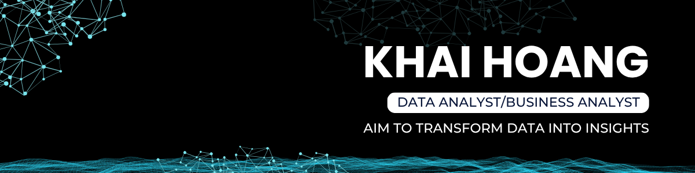
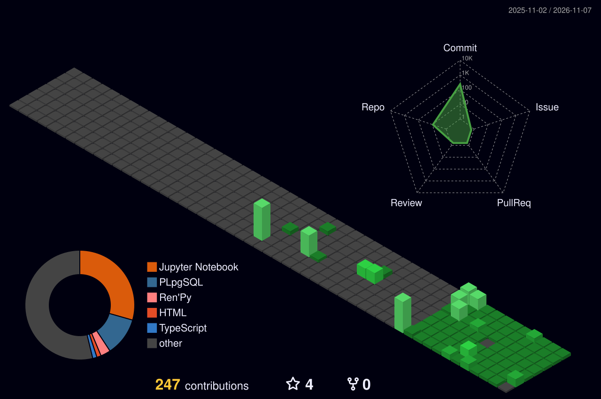
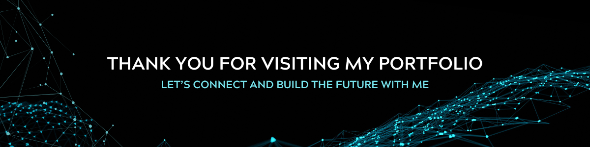

<p align="center">
  
</p>

<p align="center">
  
</p>

<h1 align="center">Hi 👋, I'm Khai</h1>
<h3 align="center">Business Analytics Student | Aspiring Business Analyst</h3>

<p align="center">
  Turning business questions into data pipelines, dashboards, and decision-support analysis.<br/>
  <strong>Seeking Business Analyst / Data Analyst internship opportunities.</strong>
</p>

<p align="center">
  <a href="https://www.linkedin.com/in/khaihoanggia/"></a>
  <a href="mailto:khaihoanggia.work@gmail.com"></a>
</p>

---

### 🎯 About Me

```yaml
khai:
  education: "Bachelor of Business – Business Analytics, Western Sydney University"
  gpa: "3.6 / 4.0"
  philosophy: "Bridging business questions with data-driven answers"
  focus:
    - "Business requirements, process mapping & stakeholder communication"
    - "SQL & Python pipelines, Power BI dashboards & customer insights"
    - "Explainable machine learning with business-focused evaluation"
  currently: "Seeking Business Analyst / Data Analyst internships"
```

---

### 💼 Featured Projects

#### 🚲 [TNBike — Order Automation & Dealer Analytics](https://github.com/Faewon/DataExplorers2026V2-Aura-Farmers)

**Business question:** How can a bicycle distributor automate order processing and identify dealer-retention opportunities?

- **Team solution:** Email/PDF order ingestion with Airflow, a PostgreSQL Medallion warehouse, six Power BI dashboards, and demand forecasting.
- **Analysis:** RFM segmentation, cohort retention, product performance, and geographic trends to support dealer follow-up and inventory planning.
- **Project result:** The repository reports **1,132 / 1,132 emails processed successfully** in the competition dataset.

`Power BI` `DAX` `PostgreSQL` `Python` `Airflow` `Docker`

[📂 Repository](https://github.com/Faewon/DataExplorers2026V2-Aura-Farmers) · [📊 Dashboard Gallery](https://github.com/Faewon/DataExplorers2026V2-Aura-Farmers/tree/main/B.%20Dashboards%20v%C3%A0%20Insights/dashboard) · [📄 Project Report](https://github.com/Faewon/DataExplorers2026V2-Aura-Farmers/blob/main/Report_AuraFarmers_DataExplorersV2.pdf)

#### 🏦 [Mortgage Application Analytics & Underwriting Workflow Prototype](https://github.com/Faewon/CreditRisk-LoanDefault-PredictionEngine)

**Business question:** How can public mortgage data support application-decision analysis and a proposed underwriting workflow?

- **Data foundation:** Approximately **2.78 million HMDA records**, integrated with FRED macroeconomic and FDIC banking data through a Bronze → Silver → Gold pipeline.
- **Analytics:** Application-denial classification and a **five-page Power BI dashboard** covering application exposure, segmentation, macro trends, scenario analysis, and model performance.
- **Business analysis:** BRD, As-Is / To-Be BPMN diagrams, data-flow diagrams, user stories, and a RACI matrix connecting requirements to a proposed process redesign.

> Portfolio prototype: the documented model target is application denial, rather than observed loan default. Workflow benefits and stress scenarios represent proposed or modeled outcomes.

`Python` `pandas` `XGBoost` `Power BI` `BPMN` `Business Analysis`

[📂 Repository](https://github.com/Faewon/CreditRisk-LoanDefault-PredictionEngine) · [📊 Dashboard Gallery](https://github.com/Faewon/CreditRisk-LoanDefault-PredictionEngine/tree/main/B.%20ML%20%26%20Analytics/dashboard) · [📋 BA Artifacts](https://github.com/Faewon/CreditRisk-LoanDefault-PredictionEngine/tree/main/C.%20BA%20Artifacts)

#### 💳 [Credit Card Fraud Detection — Explainable Risk Prioritization](https://github.com/Faewon/Credit-Card-Fraud-Detection)

**Business question:** How can suspicious transactions be prioritized while balancing missed fraud and unnecessary reviews?

- **Modeling:** Compared Random Forest, XGBoost, and LightGBM on imbalanced transaction data; the reported XGBoost cross-validation **AUC-PR is ~0.836 ± 0.028**.
- **Explainability:** Probability calibration and SHAP analysis to make risk scores easier to interpret.
- **Decision support:** Four adjustable risk tiers connect scores to proposed approve, review, analyst-escalation, and decline actions in an offline modeling workflow.

`Python` `scikit-learn` `XGBoost` `LightGBM` `SHAP`

[📂 Repository](https://github.com/Faewon/Credit-Card-Fraud-Detection) · [📓 Analysis Notebook](https://github.com/Faewon/Credit-Card-Fraud-Detection/blob/main/fraud_detection.ipynb) · [📈 Evaluation & Results](https://github.com/Faewon/Credit-Card-Fraud-Detection#results)

---

### 🏆 Highlights

- 🥉 **3rd Prize** — Team Aura Farmers, Data Explorers 2026 Hackathon
- 🚀 **Top 29** — Hack-A-Venture 2025 Startup Competition
- 👥 **President, The Film Makers Crew** — led a 40+ member team
- 🗣️ **IELTS 7.0** | Microsoft Office Specialist (MOS) Certified

---

### 🛠️ Tech Stack

| Category | Tools & Capabilities |
|---|---|
| **Business Analysis** | Requirements documentation · Process mapping · Market research · Customer journeys · Stakeholder collaboration |
| **Languages & Libraries** |      |
| **Database** |    |
| **BI & Visualization** |    |
| **DevOps & Tools** |    |
| **Project & Knowledge** |      |
| **Design** |  |

---

### 📊 GitHub Stats

<div align="center">
  <table>
    <tr>
      <td width="55%" align="center" valign="middle">
        
      </td>
      <td width="45%" align="center" valign="middle">
        
        <br/><br/>
        
      </td>
    </tr>
  </table>
</div>

<p align="center">
  
</p>
